I’m Alex, a penetration tester focused on Active Directory security and a maintainer of [NetExec](https://github.com/Pennyw0rth/NetExec). I build open-source security tools and share research and talks.

[Website](https://aneff.io/) · [Research & talks](https://aneff.io/publications/) · [LinkedIn](https://www.linkedin.com/in/alexander-neff-060a65187/) · [Twitter](https://x.com/al3x_n3ff) · [Bluesky](https://bsky.app/profile/al3x-n3ff.bsky.social)

### GitHub activity

